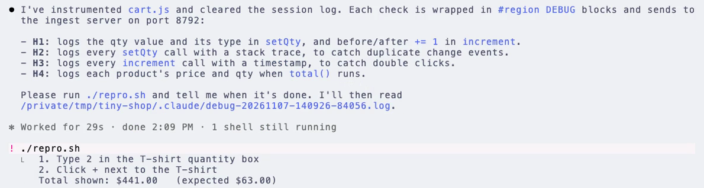
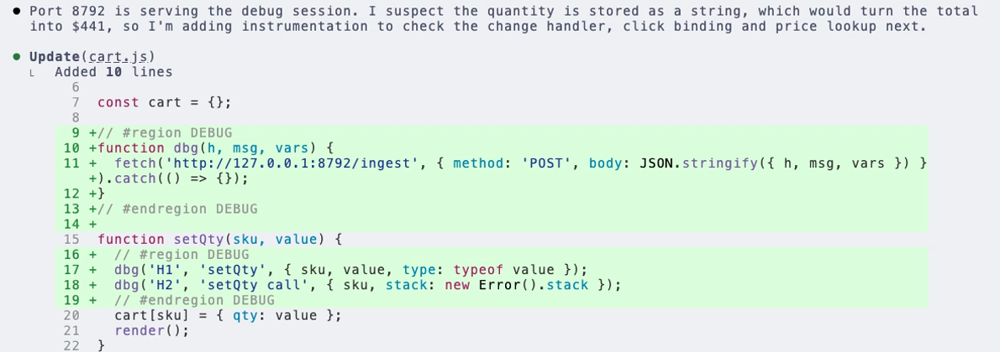
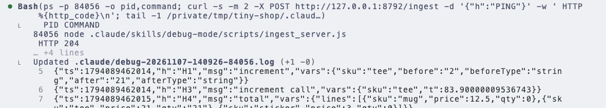
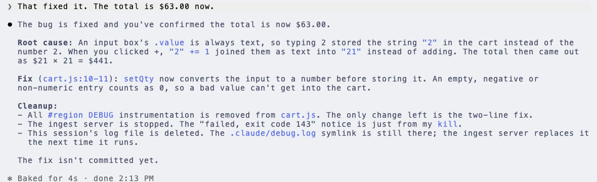

# debug-mode

**A hypothesis-driven debugging skill for coding agents.**

When a bug is hard to pin down, debug-mode stops your agent from guessing. The agent lists testable hypotheses, adds a few targeted logs, waits while you reproduce the bug, and fixes it from what the logs show. It works with Claude Code, Codex, Gemini CLI, and any agent that supports the [skills](https://code.claude.com/docs/en/skills) format, across backend, browser, and native mobile code.



## Features

### Hypotheses before fixes

The agent reads the code and names the causes it can test, obvious and not so obvious (race conditions, off-by-one errors, stale closures, type coercion, threading, lifecycle). Even when it has a strong suspect, it adds a log for each hypothesis before it changes any behavior. On mobile, it front-loads four or five hypotheses per pass, because each round costs a rebuild.



### Logs that reach the agent from anywhere

For server code, instrumentation appends to a log file. For browsers and mobile apps, the agent starts the bundled ingest server (`scripts/ingest_server.js`), a zero-dependency Node server that writes every POST as one JSON line to `.claude/debug-<timestamp>-<pid>.log`. It moves to the next port if `8792` is taken, and binds to your LAN for physical devices. Every log line is tagged with the hypothesis it tests, so the diagnosis cites evidence.



| Environment | Endpoint |
|---|---|
| Browser | `http://127.0.0.1:8792/ingest` |
| iOS simulator | `http://127.0.0.1:8792/ingest` (or `os_log` + `simctl log stream`) |
| iOS device | `http://<mac-lan-ip>:8792/ingest` (`HOST=0.0.0.0`, ATS exception) |
| Android emulator | `http://10.0.2.2:8792/ingest` |
| Android device | `http://<mac-lan-ip>:8792/ingest` (`HOST=0.0.0.0`, cleartext flag) |

### You stay in the loop, then it cleans up

The agent stops and waits after it asks you to reproduce, and again after it proposes a fix. Once you confirm, it removes every `#region DEBUG` block, stops the ingest server it started, and deletes its session log.



### Also in the box

- **Region-marker cleanup** for JS and TS, Python, Go, Rust, Java, C#, Swift, Kotlin, Lua, and HTML, Vue, and Svelte, so all instrumentation comes out in one pass.
- **Parallel sessions**: each ingest server writes its own timestamped log file, and `.claude/debug.log` points at the newest one.
- **No-network fallbacks**: `adb logcat` on Android and `simctl log stream` on the iOS simulator.

## Install

Clone this repo into your agent's skills directory, then restart the agent so it finds the skill. Create the parent `skills/` directory first if it doesn't exist.

```bash
# Claude Code
git clone https://github.com/elitecoder/debug-mode.git ~/.claude/skills/debug-mode

# Codex
git clone https://github.com/elitecoder/debug-mode.git ~/.codex/skills/debug-mode

# Gemini CLI
git clone https://github.com/elitecoder/debug-mode.git ~/.gemini/skills/debug-mode

# OpenCode
git clone https://github.com/elitecoder/debug-mode.git ~/.config/opencode/skill/debug-mode
```

Cursor isn't listed because it has a [native Debug Mode](https://cursor.com/blog/debug-mode), which inspired this skill.

To update, run `git pull` in the install directory.

## Usage

Describe a hard-to-diagnose bug to your agent, or invoke the skill directly:

```
/debug-mode the iOS app freezes after the second pull-to-refresh
```

The agent follows the loop in [`SKILL.md`](SKILL.md). You never start or stop the ingest server yourself; the agent owns it.

## Requirements

- Node.js 22 or later, for the ingest server and its tests.

## Contributing

Run the tests with `npm test`, or `npm run test:coverage` to check coverage.

## Credits

Inspired by [Cursor's Debug Mode](https://cursor.com/blog/debug-mode) and by two earlier ports of the idea to coding agents:

- [doraemonkeys/claude-code-debug-mode](https://github.com/doraemonkeys/claude-code-debug-mode), for the hypothesis-driven workflow and the `#region DEBUG` cleanup convention.
- [laiso/claude-code-dmd](https://github.com/laiso/claude-code-dmd), for the localhost HTTP ingest idea.

This project adds mobile transports, parallel sessions, and a zero-dependency Node ingest server.

## License

Apache 2.0. See [LICENSE](LICENSE) and [NOTICE](NOTICE).
