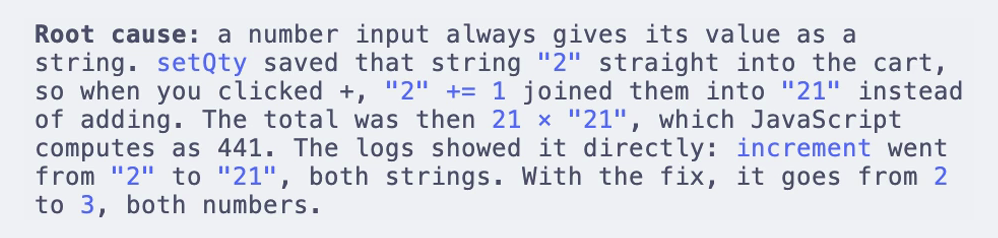
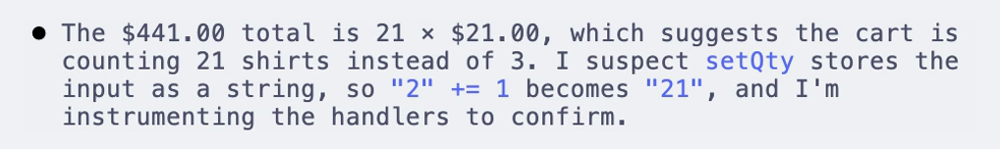
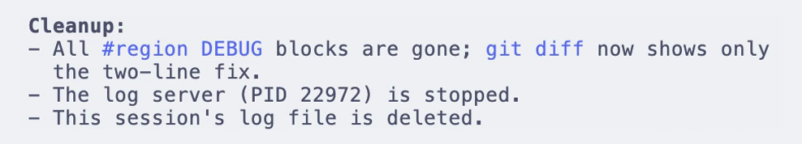

# debug-mode

**A hypothesis-driven debugging skill for coding agents.**

Your agent tests hypotheses with real logs instead of guessing, then fixes the bug from the evidence. It works with Claude Code, Codex, Gemini CLI, and other agents that support [skills](https://code.claude.com/docs/en/skills).



## Features

### Hypotheses first

The agent states what it suspects and adds a log for each hypothesis before it changes any code. You see why it believes the fix, not just the fix.



### Logs from browser and phone

A bundled zero-dependency ingest server collects logs over HTTP from browsers, simulators, and devices. Bugs that only happen outside the terminal still leave evidence the agent can read.


### Cleans up after itself

Once you confirm the fix, the agent removes every `#region DEBUG` block, stops the server, and deletes its log. Your diff ends up with only the fix.



### Also in the box

- Region markers for JS and TS, Python, Go, Rust, Java, C#, Swift, Kotlin, Lua, and HTML, Vue, and Svelte.
- Parallel sessions, each with its own timestamped log file.
- Fallbacks without network: `adb logcat` on Android and `simctl log stream` on the iOS simulator.

## Install

Clone this repo into your agent's skills directory, then restart the agent so it finds the skill. Create the parent `skills/` directory first if it doesn't exist.

```bash
# Claude Code
git clone https://github.com/elitecoder/debug-mode.git ~/.claude/skills/debug-mode

# Codex
git clone https://github.com/elitecoder/debug-mode.git ~/.codex/skills/debug-mode

# Gemini CLI
git clone https://github.com/elitecoder/debug-mode.git ~/.gemini/skills/debug-mode

# OpenCode
git clone https://github.com/elitecoder/debug-mode.git ~/.config/opencode/skill/debug-mode
```

Cursor isn't listed because it has a [native Debug Mode](https://cursor.com/blog/debug-mode), which inspired this skill.

To update, run `git pull` in the install directory.

## Usage

Describe a hard-to-diagnose bug to your agent, or invoke the skill directly:

```
/debug-mode the iOS app freezes after the second pull-to-refresh
```

The agent follows the loop in [`SKILL.md`](SKILL.md). You never start or stop the ingest server yourself; the agent owns it.

## Transports

The agent starts the ingest server (`scripts/ingest_server.js`) itself. It writes each POST as one JSON line to `.claude/debug-<timestamp>-<pid>.log`, moves to the next port if `8792` is taken, and binds to your LAN with `HOST=0.0.0.0` for physical devices.

| Environment | Endpoint |
|---|---|
| Browser | `http://127.0.0.1:8792/ingest` |
| iOS simulator | `http://127.0.0.1:8792/ingest` (or `os_log` + `simctl log stream`) |
| iOS device | `http://<mac-lan-ip>:8792/ingest` (`HOST=0.0.0.0`, ATS exception) |
| Android emulator | `http://10.0.2.2:8792/ingest` |
| Android device | `http://<mac-lan-ip>:8792/ingest` (`HOST=0.0.0.0`, cleartext flag) |

## Requirements

- Node.js 22 or later, for the ingest server and its tests.

## Contributing

Run the tests with `npm test`, or `npm run test:coverage` to check coverage.

## Credits

Inspired by [Cursor's Debug Mode](https://cursor.com/blog/debug-mode) and by two earlier ports of the idea to coding agents:

- [doraemonkeys/claude-code-debug-mode](https://github.com/doraemonkeys/claude-code-debug-mode), for the hypothesis-driven workflow and the `#region DEBUG` cleanup convention.
- [laiso/claude-code-dmd](https://github.com/laiso/claude-code-dmd), for the localhost HTTP ingest idea.

This project adds mobile transports, parallel sessions, and a zero-dependency Node ingest server.

## License

Apache 2.0. See [LICENSE](LICENSE) and [NOTICE](NOTICE).
